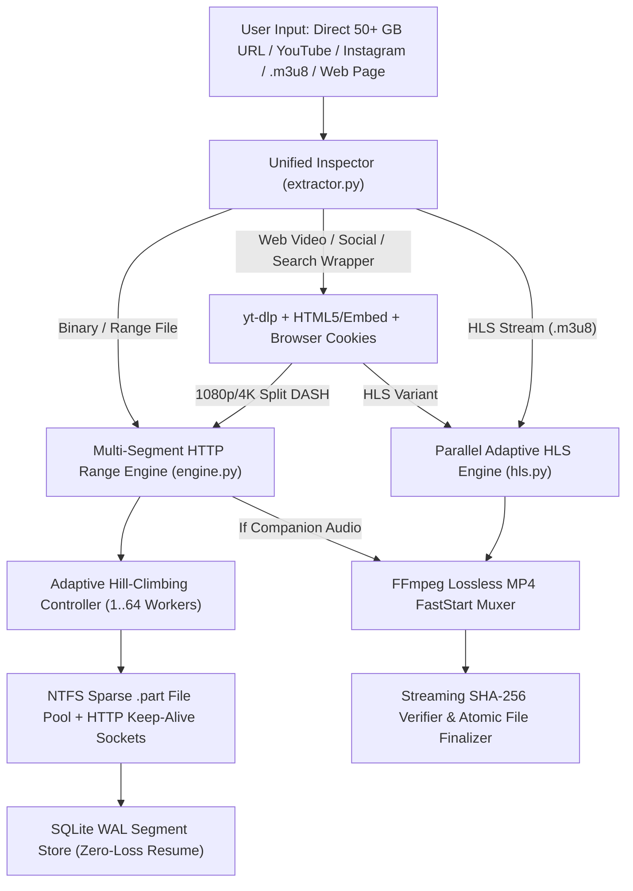

# Happydownload v2.0.0

<p align="center">
  
</p>

<p align="center">
  
</p>

**Adaptive Multi-Stream 50+ GB File & 4K Web Video Download Engine**  
*Architected & Developed by **Aswin Lal S Y***

[](https://github.com/aswinlal1904/Happydownload/releases)
[](https://pypi.org/project/happydownload/)
[](https://www.python.org/)
[](LICENSE)

Happydownload is a crash-proof, adaptive multi-connection download engine engineered to download **massive 50+ GB movie/archive files**, **HLS (`.m3u8`) streams**, and **web videos from 1,500+ platforms** (YouTube, Instagram Reels/Posts, TikTok, X/Twitter, Vimeo, Dailymotion, Reddit, and generic HTML5 video pages) at maximum possible bandwidth without data loss.

---

## Key Highlights

- **Adaptive Hill-Climbing Concurrency Engine:** Continuously measures EWMA throughput every 2.5s and dynamically scales parallel connections (`1..64`) up while bandwidth increases, or backs off automatically on HTTP `429`/`503` throttling and high-latency stalls.
- **Instant 50+ GB NTFS Sparse File I/O (`FSCTL_SET_SPARSE`):** Starts writing multi-gigabyte segments at millisecond zero without freezing the disk with synchronous zero-fill allocation, while pre-validating free space and `FAT32` 4 GB limits.
- **Crash-Proof SQLite WAL Byte-Level Checkpointing:** Every segment's exact byte offset is persisted in an atomic Write-Ahead Log database (`data/segments/<id>.db`). Survives power loss, Wi-Fi drops, expired CDN tokens, and OS restarts with **zero lost bytes**.
- **Dynamic Tail Work-Stealing:** Fast idle worker threads automatically split the remaining tail of slow segments (`>= 4 MiB` remaining) so the final 1% of a 60 GB download never bottlenecks on a single slow TCP socket.
- **Universal Web Video & Social Media Extractor:**
  - **1080p / 2K / 4K DASH Video + Audio Muxing:** Automatically pairs high-resolution video-only streams with the highest-bitrate audio track and losslessly merges them into fast-start `.mp4` via FFmpeg.
  - **YouTube, Instagram Reels/Posts, TikTok, X/Twitter, Facebook, Vimeo:** Built-in `yt-dlp` integration + browser session cookie authentication (`Edge`, `Chrome`, `Firefox`, `Brave`) + public Instagram embed fallback + native `yt-dlp` chunked stream fallback.
  - **Parallel Adaptive HLS (`.m3u8`) Engine:** Parses master/media playlists, downloads `.ts`/`fMP4` segments in parallel with adaptive scaling, assembles contiguously, and remuxes to `.mp4`.
  - **Search Wrapper Unwrapping:** Automatically unwraps Bing Video Search (`relatedvideo` / `vrhm` / `mid`) and redirect wrappers into their underlying source video URLs.
- **Hybrid Desktop & Web UI + Win32 System Tray + CLI:**
  - **Standalone Desktop App Mode (`--desktop`):** Launches a dedicated chromeless desktop application window paired with a pure-Win32 System Tray icon.
  - **Local Web UI:** Real-time Server-Sent Events (`/api/events`) telemetry dashboard with live speed chart, 80-bucket Segment Integrity Map, batch multi-link downloader, playlist quality presets, overnight bandwidth scheduler, clipboard link detector, and orphan `.part` cleaner.

---

## How It Works (Architecture)



---

## Standalone Desktop App vs. Web UI — Which Is Better?

Happydownload uses a **Hybrid Local Engine Architecture** so you get the advantages of both:

| Deployment Mode | Command | Best For | Why It Excels |
| :--- | :--- | :--- | :--- |
| **Standalone Desktop App (Recommended)** | `python main.py --desktop` *(or double-click `launch_desktop.bat`)* | Everyday Windows desktop use | Opens a dedicated, chromeless native application window + Windows System Tray icon while keeping direct OS filesystem (`FSCTL_SET_SPARSE`), sleep-prevention, and native folder picker access. |
| **Local Web UI** | `python main.py` | Browser workflow or remote LAN control (`--host 0.0.0.0`) | Zero heavy GUI framework bloat (no 200 MB Electron bundle); accessible from any browser tab at `http://127.0.0.1:8765`. |
| **Background System Tray** | `python main.py --tray --no-browser` | Overnight 50+ GB downloads | Runs silently in the Windows notification area with right-click *Pause All / Resume All / Open UI*. |
| **Command-Line (CLI)** | `python main.py download <URL>` | Automation, scripts & headless servers | Live terminal progress bar with full adaptive multi-connection acceleration. |

> **Why not a pure cloud-hosted web app?** A remote cloud web server downloads files to the *server's* disk first and still forces your browser to download the 50+ GB file over a single browser stream. Running the Happydownload engine locally gives you **raw multi-socket TCP concurrency, NTFS sparse disk writes, local FFmpeg 4K muxing, and Windows power management** right on your machine.

---

## Installation & Quick Start

### 1. Prerequisites
- **Python 3.10+** (zero third-party libraries required for the core 50+ GB HTTP Range & HLS downloader).
- **yt-dlp** *(recommended for YouTube, Instagram, TikTok, and 1,500+ video sites)*:
  ```bash
  pip install -r requirements.txt
  ```
- **FFmpeg** *(recommended for 1080p/4K video+audio merging and HLS `.ts` &rarr; `.mp4` remuxing)*:
  ```powershell
  winget install --id Gyan.FFmpeg -e
  ```

### 2. Run Happydownload

- **Double-Click Windows `.exe` (No terminal required):**
  - Double-click **`Happydownload.exe`** in the project folder (or distribute the self-contained standalone **`dist\Happydownload.exe`** to any Windows PC, even without Python installed).
  - **Automatic FFmpeg Handling for End-Users:** When another user runs `Happydownload.exe` on a PC without FFmpeg installed, Happydownload checks portable folders (`./ffmpeg.exe`, `./bin/ffmpeg.exe`, `./data/bin/ffmpeg.exe`), system `PATH`, WinGet, Scoop, and Chocolatey—and if FFmpeg is not present, provides a **1-click Auto-Install Portable FFmpeg** button in the UI (and automatically provisions portable `ffmpeg.exe` into `data/bin/ffmpeg.exe` on-demand when merging 1080p/4K video+audio).

- **Build Standalone `.exe` From Source:**
  ```bash
  python build_exe.py
  # Or to embed ffmpeg.exe directly inside the single-file .exe:
  python build_exe.py --bundle-ffmpeg
  ```

- **Launch From Python (Standalone Desktop Window + System Tray by default):**
  ```bash
  python main.py
  ```
  *(To open in a standard web browser tab instead of the standalone desktop window, pass `python main.py --web`.)*

- **Download via CLI:**
  ```bash
  python main.py download "https://example.com/movie-60gb.mkv" --max-connections 16
  ```

---

## How To Use

1. **Downloading 50+ GB Movies & Archives:**
   - Paste the direct file link into the URL bar and click **Download** (or **Inspect Link** first to verify size, `Accept-Ranges` support, and NTFS free disk space).
   - Monitor the **Live Engine Telemetry** panel on the right for real-time speed, active/target connections, HTTP Keep-Alive socket reuses, and the 80-cell **Segment Integrity Map**.
2. **Downloading YouTube, Instagram Reels/Posts, TikTok & Web Videos:**
   - Paste any video or playlist page URL.
   - Click **Inspect Link** to preview all discovered videos on the page, choose a quality preset (**Best 4K/1080p**, **1080p Full HD**, **720p HD**, **480p**, or **Audio Only**), and click **Download Selected**.
   - **For Instagram or Age-Restricted Videos:** Click **Engine Settings** in the top bar and set **Browser Cookies** to your logged-in browser (`Microsoft Edge`, `Google Chrome`, `Mozilla Firefox`, or `Brave`).
3. **Batch Multi-Link Downloading:**
   - Click **Batch Links** next to the URL input, paste multiple file or video page URLs (one per line), and click **Download**.
4. **Recovering an Expired Link at 90% on a 50+ GB File:**
   - Select the paused/failed download, paste the newly generated CDN link into the **Replace Link / Add Mirror** box in the Telemetry panel, and click **Replace Link** &rarr; **Resume**. All previously saved segments remain intact.

---

## Running the Test Suite

Happydownload includes a 20-test unit and end-to-end integration test suite covering multi-segment SHA-256 byte accuracy, flaky drop/429 recovery, crash/restart zero-loss resume, work-stealing, expiring link refresh, mirror failover, HLS master playlist download, 4K split video+audio pairing, and search-wrapper unwrapping:

```bash
python -m unittest discover -s tests -v
```

---

## Project Metadata & Credits

- **Project:** Happydownload
- **Version:** `v2.0.0`
- **Architect & Developer:** **Aswin Lal S Y**
- **License:** [MIT License](LICENSE)
